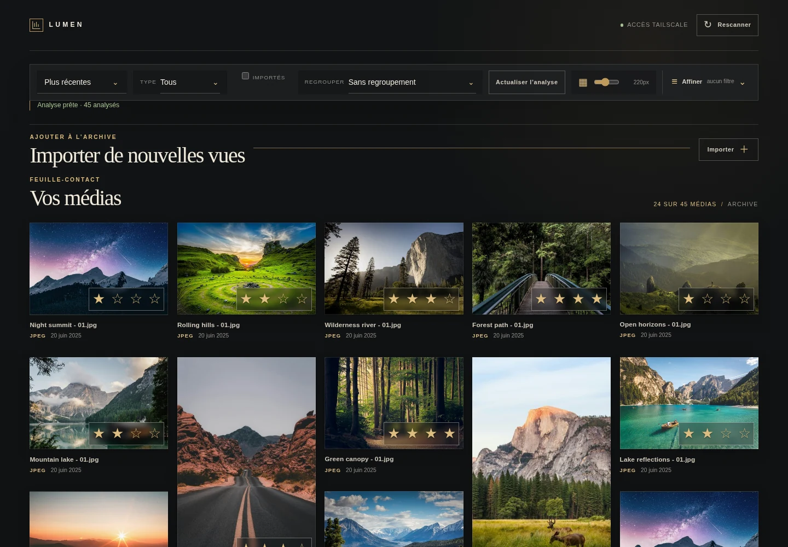
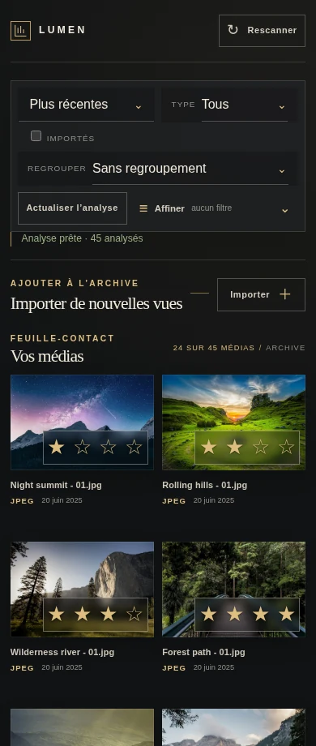
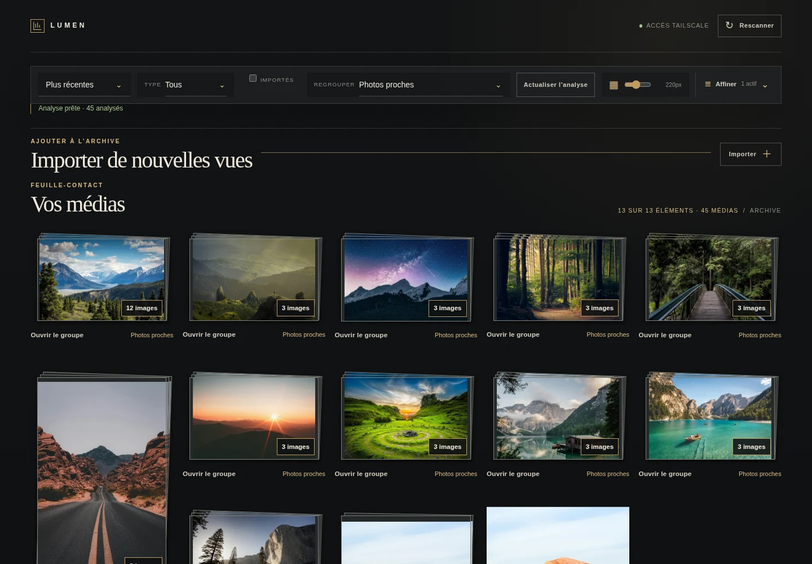
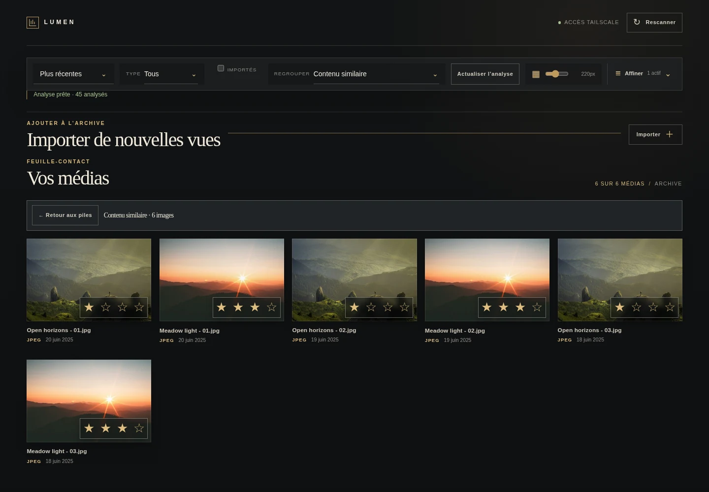
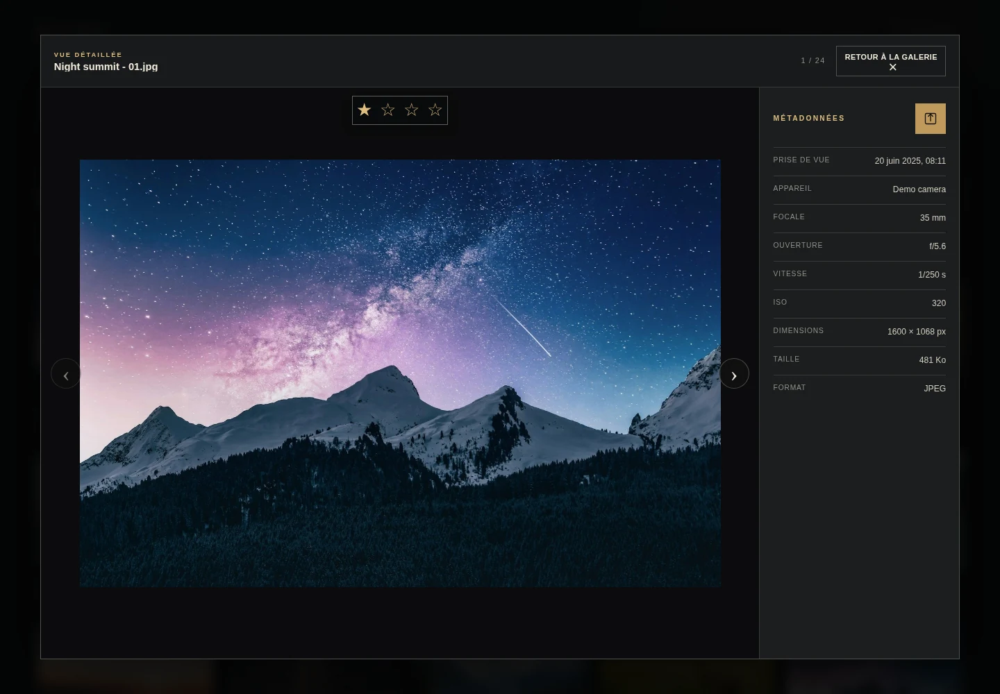

# LUMEN — Galerie privée de photos et de médias

[English](README.md) · **Français**

LUMEN est un catalogue auto-hébergé et responsive pour photographies et vidéos. Les originaux restent sur le serveur, les annotations du catalogue sont stockées dans SQLite, et l’interface permet de parcourir, filtrer, noter, partager et regrouper les images similaires.

L’interface est actuellement **en français**. La documentation anglaise ne signifie pas que l’interface de l’application a été traduite.

## Captures d’écran



Ces images sont de vraies captures d’une bibliothèque de démonstration isolée, contenant des images d’exemple Unsplash sous licence et des métadonnées de démonstration. Elles ne contiennent aucun média utilisateur ou privé. Voir la [provenance et les crédits des captures](docs/screenshots/README.md).

<p>
  
  
</p>
<p>
  
  
</p>

## Fonctionnalités

- Galerie responsive mixte photo/vidéo avec dossiers, sous-dossiers, pagination et filtres orientés métadonnées.
- Originaux en lecture seule pour le processus web ; miniatures, aperçus, copies vidéo de compatibilité, bases SQLite et imports vivent dans des zones de données séparées.
- Indexation JPEG, RAW et vidéo avec Pillow, ExifTool officiel fourni en Perl et FFprobe. Les RAW utilisent leurs aperçus JPEG embarqués ; LUMEN ne développe pas les fichiers RAW.
- Lecture vidéo native avec audio, recherche dans la durée, HTTP Range et copie de compatibilité FFmpeg mise en cache lorsque le navigateur ne peut pas lire directement la source.
- Filtres par dossier/sous-arborescence, appareil, objectif, format, date, ISO, type de média, import, corbeille programmée et note. L’API possède une recherche textuelle absente de l’interface actuelle.
- Quatre étoiles et notes entières **0–4**, stockées dans SQLite et jamais écrites dans l’EXIF. Chaque média découvert ou importé commence explicitement à 1 ; les notes 0 et supérieures sont conservées lors des rescans.
- Imports navigateur stockés à part, retrouvables avec le filtre **Importés**, puis indexés après acceptation.
- Visionneuse affichant l’image entière sans recadrage, navigation clavier/tactile, zoom borné par pincement ou double-tap de 1× à 5×, et retour à la position précédente dans la galerie.
- Partage de fichiers via l’API du navigateur quand elle est disponible. Pour un RAW, un JPEG de secours peut être proposé explicitement ; la feuille de partage du système dépend du navigateur et de l’appareil.
- Deux regroupements locaux et non destructifs : photos proches par similarité perceptuelle et contenu visuellement similaire avec CLIP. Les piles s’ouvrent en grille complète et permettent de revenir à la position précédente.
- Corbeille programmée, explicite et récupérable, plutôt qu’une suppression automatique.

LUMEN ne supprime pas automatiquement les originaux, ne fait pas de reconnaissance faciale, n’envoie pas les médias vers un service cloud et ne remplace pas silencieusement un RAW par un JPEG développé.

## Prérequis

- Python **3.12** (version testée) et `uv`.
- Perl et l’exécutable ExifTool officiel fourni dans `vendor/exiftool/exiftool`.
- `ffmpeg` et `ffprobe` dans le `PATH`, ou des chemins fournis par variables d’environnement. FFmpeg doit inclure `libx264` lorsqu’un transcodage est nécessaire.
- Node.js uniquement pour les tests JavaScript et la vérification de syntaxe ; il n’y a pas d’étape de build frontend.

## Installation

Depuis la racine du dépôt :

```bash
uv venv --python 3.12 .venv
uv pip install --python .venv/bin/python -r requirements.txt
```

ExifTool est appelé sans installation système ni `sudo` :

```bash
perl vendor/exiftool/exiftool -ver
ffprobe -version
ffmpeg -version
```

## Démarrage local sur loopback

Utiliser un chemin absolu pour le dossier des originaux. Cette commande écoute uniquement sur le port loopback `8093` :

```bash
PHOTO_ROOT='/absolute/path/to/photos' \
PHOTO_DATA_DIR="$PWD/data" \
.venv/bin/python -m uvicorn app:app --host 127.0.0.1 --port 8093
```

Ouvrir `http://127.0.0.1:8093/`. Le contrôle de santé est `/health` et la documentation interactive FastAPI est `/docs`.

L’authentification est activée par défaut. Si `PHOTO_PASSWORD` n’est pas défini, LUMEN génère une fois un mot de passe aléatoire dans `PHOTO_DATA_DIR/access-password`, avec les permissions `0600` ; consulter ce fichier en privé pour se connecter, sans jamais le commiter ni publier sa valeur dans des journaux, captures, issues ou documents. Le secret indépendant de signature des sessions est créé dans `PHOTO_DATA_DIR/session-secret` lorsqu’il n’est pas fourni explicitement.

Pour un déploiement privé et isolé uniquement, `PHOTO_AUTH_REQUIRED=false` (ainsi que `0`, `no` ou `off`) désactive la connexion applicative. N’utiliser ce mode que derrière un réseau Tailscale privé de confiance ou un reverse proxy privé ; ne jamais l’exposer sur Internet. La protection `Origin` des requêtes qui modifient l’état reste active.

Tailscale est une frontière réseau optionnelle, pas un service LUMEN hébergé. Les médias restent sur la machine où l’application et ses répertoires de données s’exécutent.

## Configuration

Les chemins relatifs sont résolus par rapport au répertoire du projet. Les chemins par défaut de la base, des imports et du cache suivent `PHOTO_DATA_DIR` si celui-ci change.

| Variable | Valeur par défaut | Rôle |
| --- | --- | --- |
| `PHOTO_ROOT` | `data/uploads` | Dossier source indexé ; garder les originaux en lecture seule pour le processus web. |
| `PHOTO_DATA_DIR` | `data` | Répertoire de données pour les bases, le cache, les modèles, les secrets et la corbeille. |
| `PHOTO_UPLOAD_DIR` | `data/uploads` | Dossier inscriptible des imports navigateur ; peut être séparé de la source. |
| `PHOTO_DB` | `data/gallery.sqlite3` | Base principale du catalogue. |
| `PHOTO_CACHE_DIR` | `data/cache` | Cache des images et vidéos générées. |
| `PHOTO_PASSWORD` | généré une fois | Mot de passe optionnel de la galerie. |
| `PHOTO_SESSION_SECRET` | généré une fois | Secret indépendant de signature des cookies. |
| `PHOTO_AUTH_REQUIRED` | `true` | Exige une session signée pour la galerie et les routes API protégées. |
| `PHOTO_MAX_UPLOAD_BYTES` | `262144000` (250 Mio) | Limite par fichier importé, exprimée en octets. |
| `PHOTO_FFMPEG` | `ffmpeg` | Chemin optionnel de l’exécutable FFmpeg. |
| `PHOTO_FFPROBE` | `ffprobe` | Chemin optionnel de l’exécutable FFprobe. |
| `PHOTO_ALLOWED_HOSTS` | vide | Noms d’hôtes supplémentaires acceptés pour les écritures ; les hôtes locaux, privés et du tailnet sont déjà autorisés. |

Le scanner refuse les chemins qui sortent des racines configurées par des liens symboliques. Les imports reçoivent un nom de stockage aléatoire ; leur nom d’origine reste une métadonnée du catalogue. Les annotations humaines sont conservées dans SQLite, jamais dans les fichiers source.

## Flux du catalogue

1. Placer les médias dans `PHOTO_ROOT` ou utiliser l’import navigateur ; ne pas mettre bases, caches ou corbeille dans la source.
2. Cliquer sur **Rescanner**, ou appeler `POST /api/scan` après authentification. Le scan est asynchrone et un seul scan peut s’exécuter à la fois ; attendre sa fin avec `GET /api/status`.
3. Les imports utilisent `PHOTO_UPLOAD_DIR` et déclenchent un scan après les fichiers acceptés. Utiliser **Importés** pour les distinguer de la source.
4. La similarité est une opération manuelle distincte. Après le scan du catalogue, cliquer sur **Analyser** ou appeler `POST /api/similarity/analyze` ; l’apparition d’un fichier ne signifie pas qu’il a rejoint une analyse terminée.
5. Les notes, annotations et métadonnées de maintenance sont conservées lorsqu’un fichier inchangé est rescanné.

## Gestion des médias

### Photos et RAW

Les JPEG sont lus directement. Pour les RAW, ExifTool extrait `JpgFromRaw` ou `PreviewImage` afin de produire miniatures, aperçus et signatures locales de similarité. Il n’y a ni dématriçage RAW ni conversion cloud ; le téléchargement de l’original reste le fichier original. Les JPEG générés, corrigés pour l’orientation, vivent dans le cache et ne sont pas réécrits dans les médias source.

### Vidéo

LUMEN lit les métadonnées vidéo avec `ffprobe` et affiche les vidéos dans la même galerie et la même visionneuse que les photographies. Les commandes natives permettent lecture, audio, recherche dans la durée et, si le navigateur le permet, plein écran ; le flux accepte les requêtes HTTP Range.

Les MP4/H.264/AAC compatibles peuvent être servis directement. Les autres sources prises en charge peuvent être remuxées ou transcodées par FFmpeg en MP4 mis en cache, avec `libx264` et une piste audio compatible navigateur. Ces fichiers sont des dérivés ; la vidéo originale et ses pistes ne sont pas remplacées.

### Notes et annotations

Les notes utilisent quatre étoiles et l’intervalle entier `0..4` : cliquer sur l’étoile terminale active remet à zéro ; un média découvert/importé reçoit explicitement `1` ; les rescans actualisent les métadonnées sans écraser une note ; `0`, `2`, `3` et `4` restent intacts. Le filtre zéro exact est valide et n’est pas traité comme une entrée vide.

## Similarité visuelle locale

La similarité est optionnelle et reste locale au serveur. **Photos proches** utilise des caractéristiques perceptuelles, de couleur et de proportions pour les rafales, variantes et quasi-doublons. **Contenu similaire** utilise un modèle local CLIP ViT-B/32 ONNX sur CPU pour rapprocher des scènes et sujets visuellement liés ; ce n’est pas de la reconnaissance faciale ni une identification de personne.

Une seule action **Analyser** calcule les deux modes après un scan manuel du catalogue ; leurs critères restent indépendants et les signatures inchangées sont réutilisées. Les vidéos, photos isolées et médias non analysés restent des cartes individuelles ; les éléments en corbeille et entrées non prises en charge ne sont pas éligibles. Les groupes sont des suggestions : ils ne déplacent, renomment, notent ou suppriment jamais les originaux.

Le modèle est un téléchargement optionnel ; le serveur ne le télécharge jamais automatiquement. Le fichier est `data/models/clip-vit-base-patch32/vision_model_quantized.onnx`. Source : `Xenova/clip-vit-base-patch32`, révision `6b7c523703ae26e39be4b03774966f8571c7f523`.

```bash
MODEL_DIR="${PHOTO_DATA_DIR:-$PWD/data}/models/clip-vit-base-patch32"
MODEL_PATH="$MODEL_DIR/vision_model_quantized.onnx"
mkdir -p "$MODEL_DIR"
curl -fL --retry 2 \
  'https://huggingface.co/Xenova/clip-vit-base-patch32/resolve/6b7c523703ae26e39be4b03774966f8571c7f523/onnx/vision_model_quantized.onnx' \
  -o "$MODEL_PATH"
printf '%s  %s\n' \
  '583fd1110a514667812fee7d684952aaf82a99b959760c8d7dca7e0ab9839299' \
  "$MODEL_PATH" | sha256sum --check
```

Les routes sont `POST /api/similarity/analyze`, `GET /api/similarity/status`, `POST /api/similarity/cancel` et `GET /api/photos?similarity=near` ou `similarity=content`. Ajouter `similarity_view=stacks` pour les piles paginées, ou un `similarity_group` correspondant au mode pour ouvrir la grille complète d’un groupe. Le retour conserve la position précédente dans les piles et la grille.

## Corbeille récupérable

La corbeille est explicite et réversible : `POST /api/deletions/schedule-zero` programme les éléments notés `0` ; le délai est d’un mois calendaire, plafonné au dernier jour du mois cible ; remonter la note à au moins `1` annule la programmation ; un worker séparé fonctionne par défaut en simulation de lecture seule. Avec `--apply`, un élément arrivé à échéance est déplacé atomiquement sur le même système de fichiers vers `PHOTO_DATA_DIR/trash/{uuid}/`, avec manifeste. `--restore JOBID` restaure explicitement un élément et refuse d’écraser une destination existante.

```bash
.venv/bin/python -m gallery.trash_worker --dry-run

# Sur décision explicite seulement : déplacer les originaux arrivés à échéance.
# .venv/bin/python -m gallery.trash_worker --apply

# Restaurer un élément après examen (remplacer JOBID).
# .venv/bin/python -m gallery.trash_worker --restore JOBID
```

Le processus web ne déplace ni ne supprime définitivement les médias source. L’application n’active jamais automatiquement un timer et aucune purge définitive n’est configurée. `--apply` et `--restore` exigent un processus de maintenance distinct disposant des droits d’écriture ; le service web doit rester en lecture seule sur la source. Les contrôles revérifient note, confinement, liens symboliques, taille/mtime, même système de fichiers et collisions.

## API et authentification

Le schéma et la documentation interactive FastAPI sont disponibles sur `/docs`. Quand l’authentification est active, les routes protégées exigent une session signée ; les requêtes qui modifient l’état vérifient aussi l’hôte et `Origin`.

| Domaine | Routes |
| --- | --- |
| Santé/session | `GET /health`, `GET /api/session`, `POST /api/login`, `POST /api/logout` |
| Jobs du catalogue | `POST /api/scan`, `GET /api/status`, `POST /api/upload` |
| Navigation | `GET /api/photos`, `GET /api/facets`, `GET /api/photos/{id}` |
| Médias | `GET /api/photos/{id}/thumb`, `/preview`, `/stream`, `/download` |
| Annotations | `PATCH /api/photos/{id}/rating`, `POST /api/photos/{id}/deletion/cancel` |
| Similarité | `GET /api/similarity/status`, `POST /api/similarity/analyze`, `POST /api/similarity/cancel` |
| Corbeille | `POST /api/deletions/schedule-zero`, `GET /api/deletions/status`, `GET /api/deletions/trash` |

`/api/photos` accepte type de média, imports, dossier/sous-arborescence, appareil, objectif, format, dates, ISO, note, corbeille programmée, tri, pagination et les deux modes de similarité. Pour le travail courant, l’interface est le point de départ le plus sûr car elle conserve ensemble l’état du scan, de l’analyse, des filtres et de la visionneuse.

## Tests

```bash
.venv/bin/python -m pytest -q
node --test static/tests
node --check static/app.js
```

Les scripts Python de régression navigateur sous `static/tests` exigent une galerie réellement démarrée avec sa configuration cible. Certains modifient des notes ou annotations puis les restaurent ; lire chaque script avant de le lancer sur un catalogue de production. Ils ne remplacent pas une vérification sur appareil réel de la feuille de partage iOS.

## Carte de l’architecture

- `app.py` — application FastAPI, authentification, routes API, réponses médias et assemblage des dépendances.
- `gallery/` — configuration, catalogue SQLite, intégration ExifTool, scanner, cache image/vidéo, analyse de similarité et worker de corbeille récupérable.
- `static/` — HTML français, CSS, application navigateur et tests JavaScript.
- `tests/` — tests Python unitaires/intégration, avec de vrais jeux de données média.
- `ops/` — exemples facultatifs d’unités de service et de maintenance ; non requis pour la commande loopback ci-dessus.

LUMEN est auto-hébergé : le serveur possède les chemins du catalogue et des médias, tandis que Tailscale ou un reverse proxy éventuel sont des couches de transport et de contrôle d’accès choisies par l’opérateur, pas un service de stockage hébergé.
