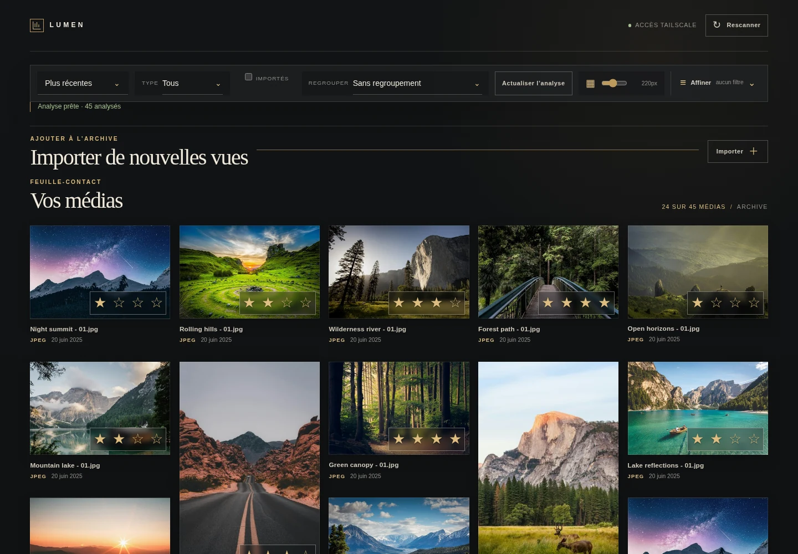
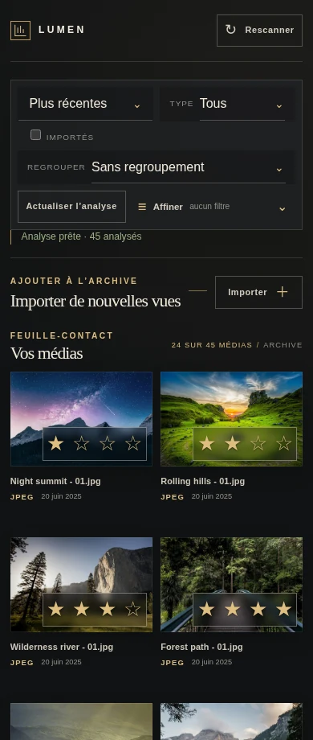
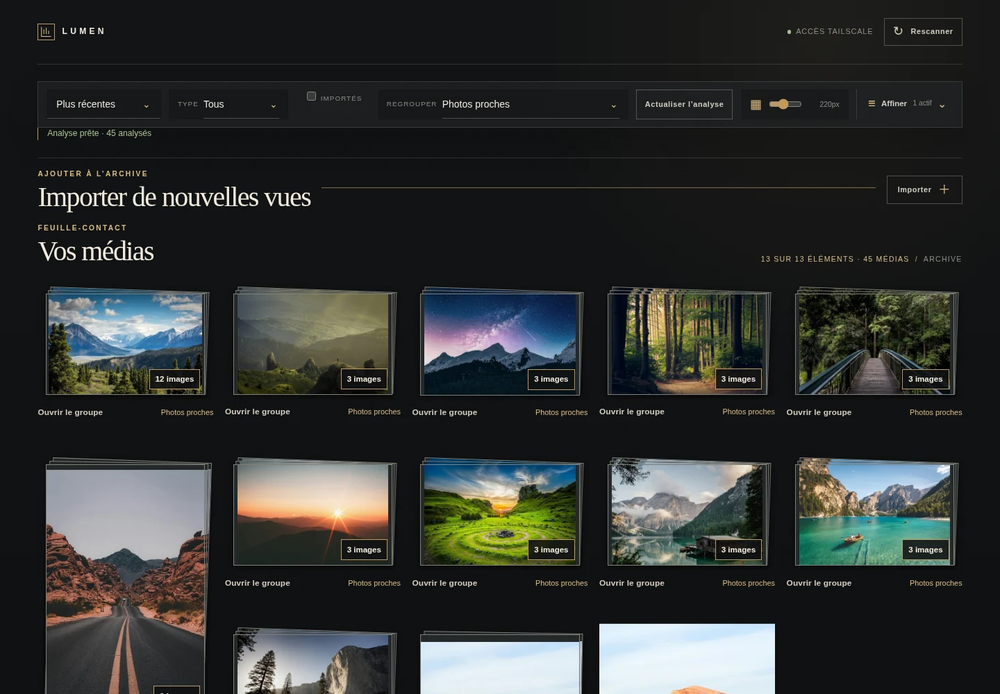
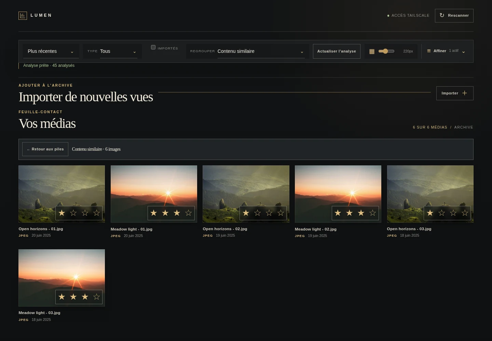
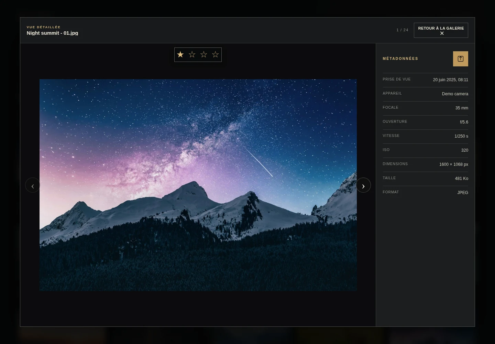

# LUMEN — Private photo and media gallery

[Français](README.fr.md) · **English**

LUMEN is a self-hosted, responsive catalogue for photographs and videos. Originals stay on the server, catalogue annotations live in SQLite, and the browser interface covers browsing, filtering, rating, sharing, and local visual similarity.

The interface is currently **French**. English documentation does not imply that the application UI has been translated.

## Screenshots



These are real screenshots from an isolated demonstration library using licensed Unsplash sample images and demonstration metadata. They contain no user or private media. See the [screenshot provenance and credits](docs/screenshots/README.md).

<p>
  
  
</p>
<p>
  
  
</p>

## Features

- Responsive mixed photo/video gallery with folders, subtrees, pagination, and metadata-oriented filters.
- Read-only originals for the web process; thumbnails, previews, video compatibility copies, databases, and uploads live in separate data areas.
- JPEG, RAW, and video indexing through Pillow, vendored Perl ExifTool, and FFprobe. RAW files use embedded JPEG previews; LUMEN does not develop RAW data.
- Native video playback with audio, seeking, HTTP Range support, and a cached FFmpeg compatibility copy when the browser cannot use the source directly.
- Folder/subtree, camera, lens, format, date, ISO, media-type, import, scheduled-trash, and rating filters. The text-search API exists even though the current UI has no search field.
- Four visible stars with integer ratings **0–4**, stored in SQLite and never written to EXIF. New discovered/imported media starts explicitly at 1; rescans preserve deliberate zero and higher ratings.
- Browser uploads stored separately from the source tree, with an **Importés** (Imported) filter and a scan after accepted uploads.
- Viewer with contain mode, keyboard/touch navigation, bounded pinch/double-tap zoom from 1× to 5×, and return-to-gallery position preservation.
- File sharing through the browser sharing API when supported. RAW sharing can offer an explicit JPEG fallback; the operating-system share sheet is browser/device dependent.
- Two local, non-destructive similarity views: perceptual near-duplicates and CLIP-based visual content similarity. Stacks open into a full group grid and return to the previous browsing position.
- Explicit, recoverable trash scheduling rather than automatic deletion.

LUMEN does **not** automatically delete originals, perform face recognition, send media to a cloud service, or silently replace a RAW original with a developed JPEG.

## Requirements

- Python **3.12** (tested runtime) and `uv`.
- Perl and the vendored official ExifTool executable at `vendor/exiftool/exiftool`.
- `ffmpeg` and `ffprobe` on `PATH`, or paths supplied through environment variables. FFmpeg needs `libx264` when an input must be transcoded.
- Node.js only for JavaScript tests and syntax checks; there is no frontend build step.

## Install

From the repository root:

```bash
uv venv --python 3.12 .venv
uv pip install --python .venv/bin/python -r requirements.txt
```

ExifTool is invoked without a system package or `sudo`:

```bash
perl vendor/exiftool/exiftool -ver
ffprobe -version
ffmpeg -version
```

## Quick start on loopback

Use an absolute source directory for the originals. This command binds only to loopback port `8093`:

```bash
PHOTO_ROOT='/absolute/path/to/photos' \
PHOTO_DATA_DIR="$PWD/data" \
.venv/bin/python -m uvicorn app:app --host 127.0.0.1 --port 8093
```

Open `http://127.0.0.1:8093/`. The health check is `/health`; FastAPI's interactive API documentation is `/docs`.

Authentication is enabled by default. If `PHOTO_PASSWORD` is unset, a random password is generated once in `PHOTO_DATA_DIR/access-password` with mode `0600`; retrieve it privately to sign in, and never commit it or include it in logs, screenshots, issues, or documentation. The independent session-signing secret is generated in `PHOTO_DATA_DIR/session-secret` when not supplied explicitly.

For an isolated private deployment only, `PHOTO_AUTH_REQUIRED=false` (also `0`, `no`, or `off`) disables the application login. Use that mode only behind a trusted private Tailscale network or reverse proxy; never expose it publicly. Origin protection for state-changing requests remains active.

Tailscale is an optional network boundary, not a hosted LUMEN service. Media stays on the machine where the application and its data directories run.

## Configuration

Relative paths are resolved from the project directory. Database, upload and cache defaults follow `PHOTO_DATA_DIR` when it is changed.

| Variable | Default | Purpose |
| --- | --- | --- |
| `PHOTO_ROOT` | `data/uploads` | Source directory scanned for media; keep originals read-only to the web process. |
| `PHOTO_DATA_DIR` | `data` | Runtime directory for databases, cache, models, secrets, and trash. |
| `PHOTO_UPLOAD_DIR` | `data/uploads` | Writable browser-upload directory; it can be separate from the source. |
| `PHOTO_DB` | `data/gallery.sqlite3` | Main catalogue database. |
| `PHOTO_CACHE_DIR` | `data/cache` | Generated image and video cache. |
| `PHOTO_PASSWORD` | generated once | Optional gallery password. |
| `PHOTO_SESSION_SECRET` | generated once | Optional independent cookie-signing secret. |
| `PHOTO_AUTH_REQUIRED` | `true` | Require a signed session for the gallery and protected API routes. |
| `PHOTO_MAX_UPLOAD_BYTES` | `262144000` (250 MiB) | Per-file browser upload limit, in bytes. |
| `PHOTO_FFMPEG` | `ffmpeg` | Optional FFmpeg executable path. |
| `PHOTO_FFPROBE` | `ffprobe` | Optional FFprobe executable path. |
| `PHOTO_ALLOWED_HOSTS` | empty | Additional comma-separated hostnames accepted for state-changing requests; local/private and tailnet hosts are already allowed. |

The scanner rejects paths escaping configured roots through symlinks. Uploads receive a random storage name while their original display name remains catalogue metadata. Human annotations are stored in SQLite, not source files.

## Catalogue workflow

1. Put media inside `PHOTO_ROOT` or use browser upload; keep runtime databases, caches, and trash out of the source directory.
2. Run **Rescanner**, or authenticate and call `POST /api/scan`. Scanning is asynchronous and single-flight; wait for `GET /api/status` to finish.
3. Uploads use `PHOTO_UPLOAD_DIR` and start a scan after accepted files. Use **Importés** (Imported) to distinguish them from source-root media.
4. Similarity is a separate manual operation. After the catalogue scan, start **Analyser** or call `POST /api/similarity/analyze`; a newly indexed file is not automatically part of a completed analysis.
5. Rescans preserve existing ratings and scheduled maintenance metadata, including when technical metadata is refreshed.

## Media handling

### Photos and RAW

JPEGs are read directly. RAW files are inspected with the vendored ExifTool, which extracts `JpgFromRaw` or `PreviewImage` for thumbnails, previews, and local similarity analysis. There is no RAW demosaicing or cloud conversion; the original download remains the original file. Generated, orientation-aware JPEGs live in the cache and are not written back to source media.

### Video

LUMEN reads video metadata with `ffprobe` and presents videos in the same gallery and viewer as photographs. Native controls provide playback, audio, seeking, and optional fullscreen where supported; the stream endpoint supports HTTP Range requests.

Browser-compatible MP4/H.264/AAC inputs can be served directly. Other supported inputs may be remuxed or transcoded with FFmpeg into a cached MP4 using `libx264` and a browser-friendly audio track. Compatibility files are derived data; the original video and its tracks are not replaced.

### Ratings and annotations

Ratings use four visible stars and the integer range `0..4`: selecting the active terminal star clears it to zero; a new discovered/imported item receives explicit rating `1`; rescans update technical metadata without overwriting an existing rating; deliberate `0`, `2`, `3`, and `4` remain intact. Exact-zero filters are valid and are not treated as empty input.

## Local visual similarity

Similarity is optional and stays local to the server. **Photos proches** (Near photos) use perceptual, colour, and aspect-ratio features for bursts, variants, and near-duplicates. **Contenu similaire** (Similar content) uses a local CLIP ViT-B/32 ONNX model on CPU for related scenes and subjects; it is not face recognition or identity matching.

One **Analyser** action computes both modes after a manual catalogue scan; the modes use independent criteria, and unchanged feature signatures are reused. Videos, singletons, and unanalyzed media remain individual cards; trashed items and unsupported inputs are not eligible photograph members. Groups are suggestions only: they do not move, rename, rate, or delete originals.

The model is an optional additional download; the server never downloads it automatically. Store it at `data/models/clip-vit-base-patch32/vision_model_quantized.onnx`. Source: `Xenova/clip-vit-base-patch32`, revision `6b7c523703ae26e39be4b03774966f8571c7f523`.

```bash
MODEL_DIR="${PHOTO_DATA_DIR:-$PWD/data}/models/clip-vit-base-patch32"
MODEL_PATH="$MODEL_DIR/vision_model_quantized.onnx"
mkdir -p "$MODEL_DIR"
curl -fL --retry 2 \
  'https://huggingface.co/Xenova/clip-vit-base-patch32/resolve/6b7c523703ae26e39be4b03774966f8571c7f523/onnx/vision_model_quantized.onnx' \
  -o "$MODEL_PATH"
printf '%s  %s\n' \
  '583fd1110a514667812fee7d684952aaf82a99b959760c8d7dca7e0ab9839299' \
  "$MODEL_PATH" | sha256sum --check
```

Similarity routes are `POST /api/similarity/analyze`, `GET /api/similarity/status`, `POST /api/similarity/cancel`, and `GET /api/photos?similarity=near` or `similarity=content`. Add `similarity_view=stacks` for paginated stacks, or a mode-specific `similarity_group` for a complete group grid. Return navigation preserves the previous stack/grid position.

## Recoverable trash

Trash is explicit and reversible: `POST /api/deletions/schedule-zero` schedules catalogue items rated `0`; the grace period is one calendar month, clamped to the target month end; raising a rating to at least `1` cancels the job; and a separate worker defaults to a read-only dry run. With explicit `--apply`, due items move atomically on the same filesystem to `PHOTO_DATA_DIR/trash/{uuid}/` with a recovery manifest. `--restore JOBID` restores one job and refuses to overwrite an existing destination.

```bash
.venv/bin/python -m gallery.trash_worker --dry-run

# Explicit opt-in only: move due originals to recoverable trash.
# .venv/bin/python -m gallery.trash_worker --apply

# Restore one reviewed job (replace JOBID).
# .venv/bin/python -m gallery.trash_worker --restore JOBID
```

The web process never moves or permanently deletes source media. The application never auto-enables a timer and no permanent purge is configured. `--apply` and `--restore` require a separate maintenance process with write access; the web service should retain read-only access to the source. Safety checks revalidate rating, path containment, symlinks, source size/mtime, same-filesystem movement, and destination collisions.

## API and authentication

FastAPI's schema and interactive documentation are at `/docs`. Protected routes require a valid signed session when authentication is enabled, and state-changing requests continue to use host and `Origin` checks.

| Area | Routes |
| --- | --- |
| Health/session | `GET /health`, `GET /api/session`, `POST /api/login`, `POST /api/logout` |
| Catalogue jobs | `POST /api/scan`, `GET /api/status`, `POST /api/upload` |
| Browse | `GET /api/photos`, `GET /api/facets`, `GET /api/photos/{id}` |
| Media | `GET /api/photos/{id}/thumb`, `/preview`, `/stream`, `/download` |
| Annotations | `PATCH /api/photos/{id}/rating`, `POST /api/photos/{id}/deletion/cancel` |
| Similarity | `GET /api/similarity/status`, `POST /api/similarity/analyze`, `POST /api/similarity/cancel` |
| Trash | `POST /api/deletions/schedule-zero`, `GET /api/deletions/status`, `GET /api/deletions/trash` |

`/api/photos` supports media type, imported-only, directory/subtree, camera, lens, format, date, ISO, rating, scheduled-trash, sorting, pagination, and both similarity modes. The browser UI is the safer starting point for normal catalogue work because it keeps scan, analysis, filters, and viewer state together.

## Tests

```bash
.venv/bin/python -m pytest -q
node --test static/tests
node --check static/app.js
```

Browser-oriented Python scripts under `static/tests` require a real running gallery with its intended configuration. Some change ratings or maintenance annotations and restore them; read each script before using it on a production catalogue. They do not replace device-level confirmation of the native iOS share sheet.

## Architecture map

- `app.py` — FastAPI application, authentication, API routes, media responses, and dependency wiring.
- `gallery/` — configuration, SQLite catalogue, ExifTool integration, scanner, image/video cache, similarity analysis, and recoverable-trash worker.
- `static/` — French HTML, CSS, browser application, and JavaScript tests.
- `tests/` — Python unit/integration tests, including real media fixtures.
- `ops/` — optional service and maintenance-unit examples; not required for the loopback command above.

LUMEN is self-hosted: the server owns catalogue and media paths, while any Tailscale or reverse-proxy boundary is an operator-selected transport and access-control layer, not a hosted storage service.
